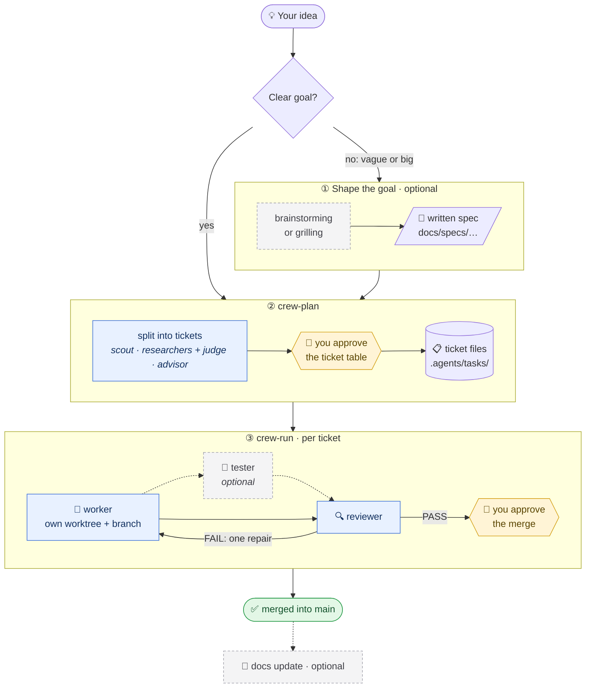

# claude-crew

Claude Code configured as a **coordinator** of role-routed **workers**. You talk to one Claude Code
session. It splits a plan into tickets and starts each ticket in its own Herdr pane, on its own git
worktree, with the model its role needs. Agents talk only through files. Hooks enforce the rules:
what a role may write, what a final report must contain, and how the coordinator steers a running
worker.

> **Status: working; field-tested on a 7-ticket project ([notes](docs/field-test-2026-11-08.md)).** All eight roles ship as agent files. Design: [`docs/specs/2026-11-03-claude-crew-design.md`](docs/specs/2026-11-03-claude-crew-design.md).
> The process in one page: [`docs/how-i-work.md`](docs/how-i-work.md).

Inspired by [Limen](https://github.com/overment/limen) (© 2026 Adam Gospodarczyk, MIT) and the
MEGA.dev lessons. This is an independent, simplified adaptation for Claude Code, not a port.

## Requirements

- Linux or macOS, bash, git, [`jq`](https://jqlang.org)
- [Claude Code](https://code.claude.com), signed in (a subscription works; all workers share its limit)
- [Herdr](https://herdr.dev) ≥ 0.8; run the coordinator inside a Herdr pane (`HERDR_ENV=1`)

## Install (once per machine)

```bash
git clone git@github.com:PasekPasek/claude-crew.git ~/projects/claude-crew
cd ~/projects/claude-crew
./install.sh          # links skills, agents and the crew CLI
crew help
```

## Start in a project (once per project)

```bash
cd /path/to/your-project
crew init
```

`crew init` never overwrites your files. It:

- adds `.agents/` to `.gitignore`;
- creates `vision.md` and `styleguide.md` stubs if they are missing;
- adds the coordinator hook (board summary at session start) to `.claude/settings.local.json`.

Then open `claude` in the project root once and accept the trust prompt. Agents run in worktrees
under `.agents/worktrees/`, and they inherit that trust; an untrusted repo stops every agent at the
dialog.

## Files you fill in

| File | Where | What to write | Size |
|---|---|---|---|
| `vision.md` | project root | What the product is, who it is for, where it is going, a short map of the main modules. Every worker reads it first. | 10–30 lines |
| `styleguide.md` | project root | Code rules the agents must follow: language, naming, tests, commit style, what never to do. Every worker reads it first. | 10–30 lines |
| `CODING_STANDARDS.md` | project root | Optional. Rules only the reviewer enforces. | short |
| `crew.json` | this repo | `max_parallel`, `max_repairs`, `permission_mode`, write globs per role. Optional: the defaults work. | — |
| `agents/crew-<role>.md` | this repo | A role: model, effort and tools in frontmatter, principles in the body. Add a file to add a role. Optional. | ≤ 40 lines |

Shape `vision.md` and `styleguide.md` together with the agent: ask it to read the repo and draft
both, then cut them down. Short files get followed; long ones get ignored.

You do **not** write tickets by hand. The coordinator writes them to `.agents/tasks/<id>/ticket.md`
after you approve its plan.

## How you work

The whole flow, from an empty idea to merged code:



Yellow steps wait for you, blue ones are agents, dashed ones are optional.

### 1. `crew init`: prepare the project (once)

Described above: it adds `.agents/` to `.gitignore`, creates `vision.md` and `styleguide.md` stubs,
installs the board hook and warns about permission rules that would stop agents. It starts no agent
and plans nothing. Fill in `vision.md` and `styleguide.md` before the first plan: every agent reads
them first, and the reviewer judges against them.

### 2. Shape the goal (optional, for vague or big goals)

crew plans well from a clear goal. When the goal is still fuzzy or large, shape it first in the
same session with one of these skills (they are not part of crew; any skill that ends in a written
spec works):

| Skill | What it does | Use it when |
|---|---|---|
| `brainstorming` | Asks you questions one at a time, proposes 2–3 approaches, writes a design spec | you know the problem, not the solution |
| `grilling` | Cross-examines your plan, one hard question per weak spot, until it holds | you have a plan and want it stress-tested |
| a PRD or your own notes | — | the spec already exists |

End with a file, not a conversation: the spec is what crew reads.

```text
Use brainstorming on: <goal>. Write the spec to docs/specs/<date>-<topic>.md and stop there.
```

### 3. Plan: the `crew-plan` skill

```text
Use crew: plan from docs/specs/<date>-<topic>.md.       (or simply: Use crew: <a clear goal>)
```

The coordinator (your session) then:

1. plans from the spec without re-interviewing you, citing it in each ticket;
2. asks a **scout** (haiku) one question about the repo if it does not know the area; sends an outside
   question (a library, an API) to two **researchers** on different models and a **judge**; sends a
   design decision with real alternatives to an **advisor**, and shows you the recommendation;
3. splits the goal into tracer-bullet tickets: thin, end-to-end slices one agent can finish in one
   fresh context, each with runnable acceptance criteria, a "Blocked by" edge, a role and a model;
   when two halves are built in parallel, the first ticket is the contract between them;
4. splits a goal bigger than about eight tickets into milestones and plans one at a time;
5. shows you the ticket table and iterates until you say ok. **Only then** it writes
   `.agents/tasks/<id>/ticket.md` files.

### 4. Run: the `crew-run` skill

1. It starts each ready ticket with `crew spawn`. A pane opens per agent; you can watch any of them.
2. When an agent finishes, its `Stop` hook checks the report and marks the task `done`; `crew watch`
   (run under Monitor) wakes the coordinator, which closes the pane and starts a **reviewer**
   (optionally a **tester** first).
3. On `PASS` it shows the diff and **asks you before every merge**. On `FAIL` it tries one repair,
   then asks you.
4. To correct a running agent, just tell the coordinator; it runs `crew steer <id> "…"` and the
   agent reads it after its next tool call.
5. After the code tickets merge, a **docs** ticket can bring the README up to date.

Check the state at any time with `crew jobs`; every step is in `.agents/journal.log` (`crew journal`).

### Permission prompts

Agents run with `permission_mode: auto` and crew allows `git add/commit/status/diff/log` for them. Claude
Code still applies **deny > ask > allow across all settings files**, so a rule like
`"ask": ["Bash(git commit:*)"]` in your `~/.claude/settings.json` stops every agent at that prompt.
`crew init` warns about such rules. While an agent waits, `crew watch` prints `<id> blocked`,
`crew jobs` shows `blocked`, and `crew peek <id>` shows what it asks; answer in its pane.

## Roles

Each role is one file in `agents/`. The model is a default: `crew spawn --model` overrides it per
ticket, so a routine review can run on sonnet and only the core on opus.

| Role | Model | Writes | Use it when | Final report starts with |
|---|---|---|---|---|
| scout | haiku | nothing | the coordinator needs one fact about this repo before planning | `ANSWER:` |
| researcher ×2 | sonnet + opus | nothing | the question is outside the repo (a library, an API); run it twice on two models | `VERDICT:` |
| judge | opus | nothing | the two researcher reports need comparing, claim by claim | `DIVERGENCE:` / `AGREE:` |
| advisor | opus | nothing | a design decision needs one recommendation, its tradeoff and a check | `RECOMMEND:` |
| worker | sonnet | its worktree | a ticket needs building | `DONE <sha>` / `BLOCKED:` |
| tester | sonnet | test files | a worker's branch needs tests it did not write itself | `PASS <sha>` / `FAIL <sha>` |
| reviewer | opus | nothing | a branch needs a verdict against its ticket before merge | `PASS <sha>` / `FAIL <sha>` |
| docs | haiku | `docs/**`, `README.md` | README and docs must catch up with merged code | `DOCS <sha>` |

Read-only roles run in a detached worktree and write only their report. Writing roles commit on their
own branch `crew/<id>`; `--branch B` says where that branch starts, so a tester spawned with
`--branch crew/T03-x` builds on the worker's commits without taking over its worktree.

## Hooks

Hooks are small bash scripts that Claude Code runs at fixed moments of an agent's life. The model
cannot skip them: they are how crew enforces its rules instead of only asking for them. All four
are no-ops outside a crew task, so your own sessions are not affected.

| Hook | When it runs | What it does | Why |
|---|---|---|---|
| `guard.sh` | before every Edit/Write/Bash (PreToolUse) | Denies, with a reason the agent reads: writes outside its worktree or outside its role's globs in `crew.json` (a reviewer writes nothing but its report, a tester only test files); `git push`, `reset --hard`, `clean -f`, `branch -D`, checking out main; writing the journal; `pkill`/`killall` | an agent cannot damage main, other agents' work or other processes, whatever it decides |
| `steer.sh` | after every tool call (PostToolUse) | Delivers new lines from `steer.md` ("Coordinator update, it outranks the ticket"); every 25 calls repeats "stay inside the ticket, report what you ran" | the coordinator can correct a running agent without interrupting it; long runs drift less |
| `stop-gate.sh` | when the agent wants to finish (Stop) | Delivers a steer that came while it was wrapping up; refuses to stop until `result.md` exists and its first line matches the role's contract (`DONE <sha>`, `PASS <sha>`, `ANSWER:` …) and, for writing roles, has `## Checks run`; then sets `status=done`; after 3 refusals sets `failed` | "done" always means a report the coordinator can parse, never a silent exit |
| `board.sh` | when the coordinator session starts (SessionStart) | Injects the `crew jobs` table and the last journal lines | a new or resumed session knows what crew is doing without being told |

## Trust boundary

Workers run as you, in git worktrees. A worktree and a hook are separation, not a sandbox. Nothing
reaches your main branch without a merge you approve.
